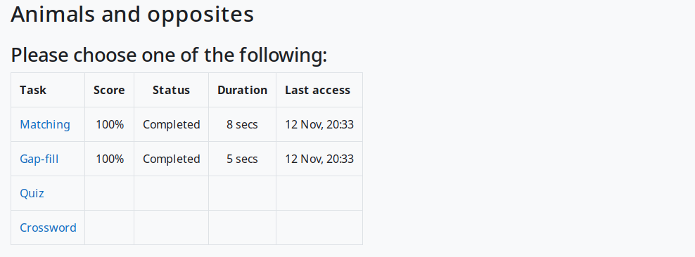
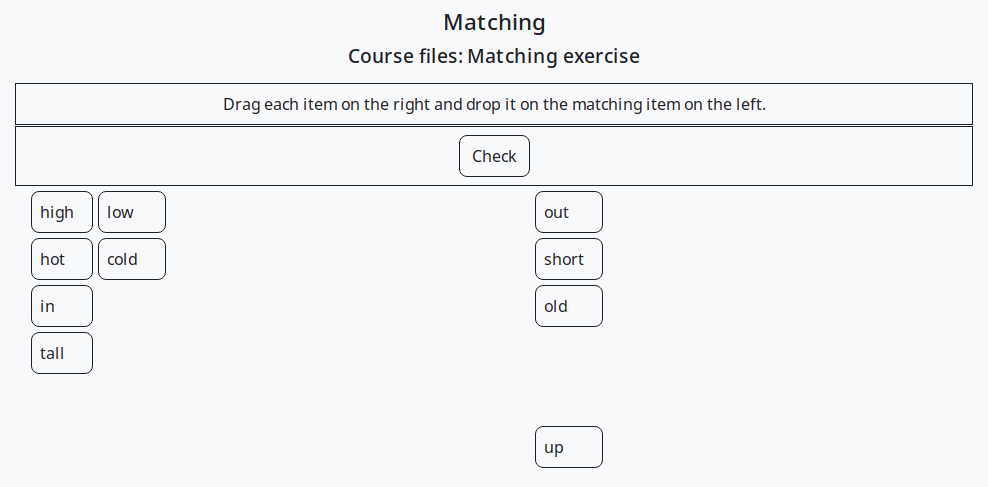
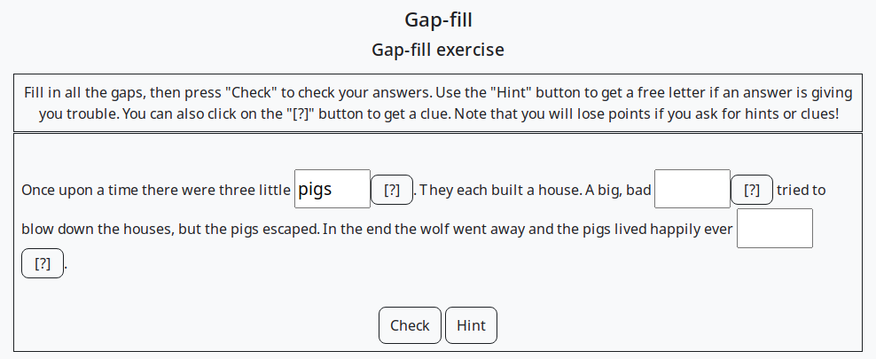
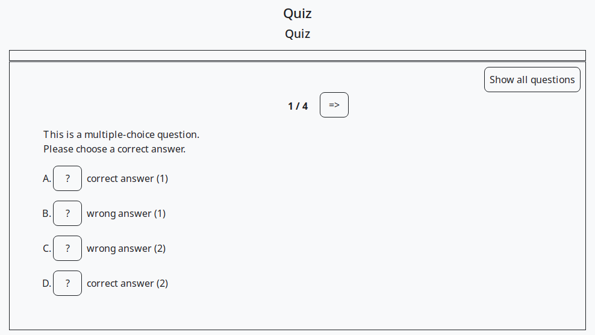
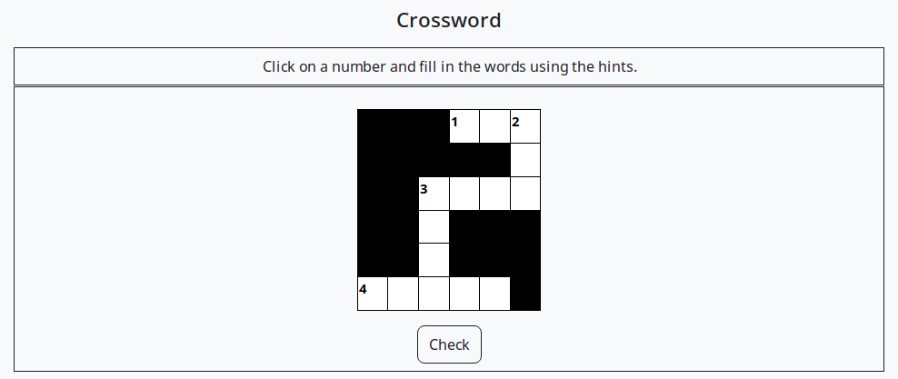
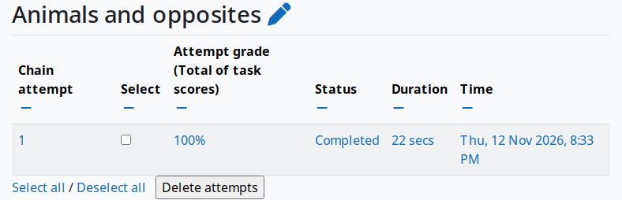

# TaskChain activity module for Moodle


TaskChain lets teachers combine several **Hot Potatoes** and other externally authored
interactive exercises into a single Moodle activity. The exercises, called *tasks*,
form a chain: students work through the tasks in order, or choose them from a menu,
and teachers can add conditions that control which task comes next.
Students' scores are saved to the Moodle gradebook, and teachers can review every
attempt and response in TaskChain's reports.

TaskChain is the successor of the QuizPort module for Moodle 1.x, and it shares much of
its code with the [HotPot](https://github.com/gbateson/moodle-mod_hotpot) module,
which handles a single exercise.

## Features

- Upload one or more Hot Potatoes 6 or 7 **data files** (`.jqz`, `.jcl`, `.jcw`, `.jmt`, `.jmx`)
  or **exported web pages** (`.htm`, `.html`); TaskChain detects the type of each file.
  The tasks in a chain can be added from a single file, from a list of files,
  or from all the files in a folder.
- **Pre-conditions** decide whether a task is available, for example only after another
  task has been completed with a minimum score. **Post-conditions** decide what happens
  after a task, depending on the student's score: repeat the same task, go to the previous,
  next or a specific task, go to a random, unseen, unanswered or incorrectly answered task,
  show a menu of tasks, or end the chain.
- Optional entry and exit pages, which can show the student's grades and links to
  the course or other activities.
- Choose how each task is displayed, including the original HP6 and HP7 layouts,
  drag-and-drop and flashcard versions.
- The grade for each chain attempt is calculated from the task scores, and the
  TaskChain grade is calculated from the chain attempts (highest, average, first or last),
  and sent to the Moodle gradebook.
- Control access with open and close dates, time limits, attempt limits,
  passwords and IP address restrictions, for the whole chain or for individual tasks.
- Reports for teachers: chain grades, chain attempts, task scores, task attempts,
  responses, item analysis and click trail.
- Activity completion conditions: minimum grade, passing grade, or "completed" status.
- Backup and restore.

## Supported exercise types

| Software | Exercise types |
|---|---|
| Hot Potatoes 6 and 7 | JQuiz, JCloze, JCross, JMatch (standard, drag-and-drop and flashcard), JMix (standard and drag-and-drop) |
| Hot Potatoes add-ons | DropDown, FindIt, JGloss and JMemori (by Michael Rottmeier), JMatch Intro, JMatch Sort, auto-advance JCloze and JQuiz, JQuiz exam, ANCT-Scan |
| TexToys | Rhubarb and Sequitur |
| Other | Xerte, iSpring, Qedoc and plain HTML pages |

## Screenshots

Click on a screenshot to see it full size. These screenshots show a chain of four
Hot Potatoes 7 tasks, with the default post-condition, which shows a menu of tasks.

| The task menu, showing the student's scores | JMatch (drag and drop) |
|:---:|:---:|
| <a href="pix/screenshots/taskmenu.png"></a> | <a href="pix/screenshots/jmatch-drag.png"></a> |
| **JCloze** | **JQuiz** |
| <a href="pix/screenshots/jcloze.png"></a> | <a href="pix/screenshots/jquiz.png"></a> |
| **JCross** | **Chain attempts report** |
| <a href="pix/screenshots/jcross.png"></a> | <a href="pix/screenshots/report.png"></a> |

## Requirements

- Moodle 2.0 or later. The current version has been tested on Moodle 5.3 with PHP 8.3,
  and the code is written to remain compatible with older versions of Moodle and PHP.
- To create exercises, you need [Hot Potatoes](https://hotpot.uvic.ca/), which is free.
  Hot Potatoes 6 is no longer available from its authors, but TaskChain still plays
  exercises created with it.

## Installation

1. Get the plugin, using any one of these methods:
   - **Moodle plugins directory:** download the zip file from
     [moodle.org/plugins/mod_taskchain](https://moodle.org/plugins/mod_taskchain),
     or install it from within Moodle via *Site administration > Plugins > Install plugins*.
   - **GitHub:** download the zip file from
     [github.com/gbateson/moodle-mod_taskchain](https://github.com/gbateson/moodle-mod_taskchain)
     (*Code > Download ZIP*), or clone the repository:
     ```
     git clone https://github.com/gbateson/moodle-mod_taskchain.git mod/taskchain
     ```
2. If you downloaded a zip file, unzip it and rename the folder to `taskchain`.
   Put this folder in the `mod` folder of your Moodle site, so that it is at `mod/taskchain`
   (not `mod/taskchain/taskchain`).
   - In Moodle 5.1 and later, the `mod` folder is inside the `public` folder,
     so the plugin goes in `public/mod/taskchain`.
3. Log in to Moodle as an administrator and go to *Site administration > Notifications*
   to complete the installation.

## Adding a TaskChain activity to a course

1. On your course page, turn on *Edit mode* and choose *Add an activity or resource > TaskChain*.
2. Under *Source file*, upload your Hot Potatoes files. Also upload any images or
   sound files that the exercises use.
3. Under *Files to be added*, choose which files become tasks, for example
   *Add all files in selected folder*.
4. If you wish, add an entry page and an exit page, and review the other settings.
5. Click *Save and display*.
6. To change the order of the tasks, change their settings, or add conditions,
   go to *Edit tasks* in the activity's navigation menu.

## Related plugins

- **HotPot:** a single Hot Potatoes exercise as a Moodle activity
  ([moodle.org](https://moodle.org/plugins/mod_hotpot),
  [GitHub](https://github.com/gbateson/moodle-mod_hotpot)).
- **HotPot question import:** imports Hot Potatoes exercises into the Moodle question bank
  ([moodle.org](https://moodle.org/plugins/qformat_hotpot),
  [GitHub](https://github.com/gbateson/moodle-qformat_hotpot)).

## Support and contributing

Please report problems and suggestions on the
[GitHub issue tracker](https://github.com/gbateson/moodle-mod_taskchain/issues).
Pull requests are welcome.

## Changes

See [CHANGES.txt](CHANGES.txt) for the history of changes to this plugin.

## Support TaskChain

TaskChain is free, and always will be. If you find it useful, you can help to keep it
up to date with new versions of Moodle and Hot Potatoes by
[sponsoring its development on GitHub](https://github.com/sponsors/gbateson),
or by making a donation via [PayPal](https://paypal.me/gordonbateson).

## Credits

TaskChain was written by Gordon Bateson. Many thanks to all the users of this module
for their feedback over the years, and to everyone who has reported issues and sent
pull requests.

In particular, I am very grateful to my erstwhile colleague Wes Cunningham, whose help,
feedback and ideas have been invaluable during the development of TaskChain and
its predecessor, the QuizPort module for Moodle 1.x.

I am also very grateful for the recognition and support that this software has received
from the Moodle Association of Japan (MAJ). Arigatō gozaimashita!

## License

TaskChain is free software, distributed under the terms of the
[GNU General Public License](https://www.gnu.org/licenses/gpl-3.0.html), version 3 or later.
It is provided "as is", without warranty of any kind.
